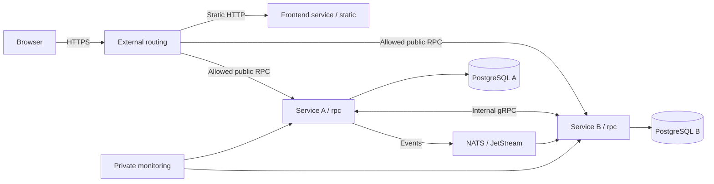

# Архитектура

[К описанию проекта](../README.md)

## 1. Роль библиотеки

BackendCore — библиотека, а не отдельный сетевой сервис, gateway или процесс-оркестратор. Каждый микросервис компилирует её в свой бинарник. Ядро не владеет схемами доменных БД, пользовательскими сессиями, бизнес-правилами, UI-компонентами или контрактами прикладных сервисов. Сервисы можно развёртывать и масштабировать независимо.



Внешняя маршрутизация и TLS termination определяются deployment, библиотека не зависит от конкретного reverse proxy. Angular вызывает публичные Connect RPC, Go-сервисы вызывают внутренние RPC напрямую (gRPC поверх того же ConnectRPC handler). Публичные процедуры разрешаются явно; авторизация остаётся в сервисах. FrontendService сам раздаёт готовый UI через опциональный `static.Module()`; RPC, Static и Management не делят listener. Management изолирован от публичной сети. PostgreSQL и NATS могут быть общими физическими кластерами при сохранении границ владения. См. [ADR RPC](adr/rpc.md) и [ADR 0010](adr/static.md).

## 2. Модули

| Пакет | Назначение | Зависимости внутри ядра |
|---|---|---|
| `app` | Метаданные, параметры приложения | — |
| `config` | Чтение и валидация конфигурации | — |
| `logging` | slog, адаптер Fx | app, config |
| `lifecycle` | Координация запуска, остановки, состояния | app, logging |
| `health` | Реестр проверок и состояние готовности | lifecycle |
| `management` | Закрытый технический HTTP ([API](management.md)) | health, logging, lifecycle |
| `static` | Раздача готовой сборки UI ([API](static.md)) | health, logging, lifecycle |
| `rpc` | ConnectRPC handlers, server/client transport, interceptors | logging, lifecycle, health |
| `nats` | Подключение, Core NATS | logging, lifecycle, health |
| `jetstream` | Надёжные публикации и consumers | nats |
| `postgres` | Пул PostgreSQL | logging, lifecycle, health |
| `postgres/orm` | GORM, основной API прикладных репозиториев | postgres, logging, lifecycle |
| `telemetry` | OTel traces и private Prometheus registry | app, config, logging, lifecycle; optional NATS/PostgreSQL snapshots и management handler |

Базовое ядро автоматически предоставляет app, config, logging, lifecycle и health registry. Оно не открывает сетевых портов, не подключается к БД или брокеру. Остальные модули добавляются явно. `jetstream` требует `nats`; `postgres/orm` требует `postgres` и использует тот же физический пул; management запускается независимо. `rpc` использует стандартный net/http, отдельный универсальный REST-модуль не планируется. `static` опционально раздаёт готовые файлы UI собственным listener. Server и client выбираются независимо внутри rpc. Telemetry не является обязательным активным модулем: optional Fx instrumentation в `internal/observe` использует OTel API и Prometheus client без создания SDK. Отдельный provider, registry и exporter принадлежат `telemetry.Module()`; см. [Telemetry](telemetry.md). Отсутствующая обязательная зависимость приводит к ошибке графа при запуске. Внешние провайдеры не должны импортировать корневой пакет из дочерних пакетов — это предотвращает циклические импорты.

Fx используется на уровне композиции. Конструкторы прикладных объектов остаются обычными Go-функциями, не получают контейнер DI и не извлекают зависимости из service locator. Пассивные владельцы сетевых ресурсов создаются при сборке графа, а соединения открываются на startup. Прикладные адаптеры используют нативные ресурсы после открытия, а не дублируют API драйверов; lifecycle и readiness координируются по правилам [Core](core.md). Интерфейсы бизнес-зависимостей определяются в потребляющем прикладном пакете. Не вводить универсальную обёртку для каждой функции сторонних библиотек: инфраструктурные адаптеры используют их непосредственно там, где это полезно.

## 3. Структура библиотеки и пример сервиса

```text
ReportBoxBackendCore/
├── app/ config/ logging/ lifecycle/ health/
├── rpc/ management/ static/
├── nats/ jetstream/
├── postgres/             # orm/ — опциональный GORM
├── telemetry/
├── internal/             # coordinator и observe
├── examples/basic-service/
├── docs/
├── core.go               # package backendcore
├── go.mod
├── go.sum
└── README.md
```

Пример структуры сервиса-потребителя:

```text
ReportBoxExampleService/
├── cmd/service/main.go
├── internal/
│   ├── domain/
│   ├── application/
│   ├── repository/
│   └── transport/       # RPC handlers
├── frontend/             # Angular remote, публикация владельцем сборки
├── api/proto/
├── migrations/
├── Dockerfile
└── go.mod
```

Не создавать пустые слои в небольших сервисах только ради структуры. Пакеты `domain`/`application` не импортируют Fx, NATS, ConnectRPC, HTTP, pgx или GORM. Адаптеры реализуют потребительские интерфейсы; ошибки домена преобразуются в протокольные ошибки на границе транспорта. Межсервисные контракты публикуются отдельно от реализации и могут иметь собственную версию. Место хранения общих Protobuf-контрактов ещё не утверждено.

## 4. Профили

| Сервис | Модули сверх ядра |
|---|---|
| Простейший фоновый процесс | Нет; опционально management |
| API без UI | rpc (server), management при необходимости |
| Сервис с Angular remote | rpc (server), нужные RPC/БД, management; UI публикуется отдельно или через static |
| FrontendService | static, management при необходимости |
| Worker | management, nats, jetstream, postgres при необходимости |
| CRUD-сервис | postgres, postgres/orm, нужные RPC и messaging |

Отдельный `go.mod` для каждого модуля пока не требуется. Один Go module проще выпускать и тестировать. Опциональное включение означает отсутствие активных ресурсов, а не гарантию отсутствия всех транзитивных зависимостей в `go.mod`.
