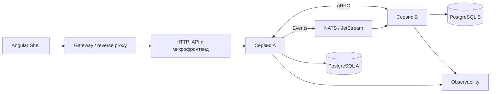

# Архитектура

[К оглавлению](../README.md)

## 1. Роль библиотеки

BackendCore — библиотека, а не отдельный сетевой сервис, gateway или процесс-оркестратор. Каждый микросервис компилирует её в свой бинарник. Ядро не владеет схемами доменных БД, пользовательскими сессиями, бизнес-правилами, UI-компонентами или контрактами прикладных сервисов. Сервисы можно развёртывать и масштабировать независимо.



Gateway (в экосистеме ReportBox рассматривается KrakenD) — внешний компонент; библиотека не реализует его конфигурацию автоматически. Маршрутизация статических файлов может выполняться отдельным reverse proxy. PostgreSQL и NATS могут быть общими физическими кластерами, но границы доступа и владения данными сохраняются.

## 2. Модули

| Пакет | Назначение | Зависимости внутри ядра |
|---|---|---|
| `app` | Метаданные, параметры приложения | — |
| `config` | Чтение и валидация конфигурации | — |
| `logging` | slog, адаптер Fx | app, config |
| `lifecycle` | Координация запуска, остановки, состояния | app, logging |
| `health` | Реестр проверок и состояние готовности | lifecycle |
| `httpserver` | Публичный HTTP и регистрация маршрутов | logging, lifecycle |
| `management` | Закрытый технический HTTP | health, httpserver (общие примитивы, не публичный listener) |
| `frontend` | Раздача статических файлов | httpserver |
| `grpcserver` | gRPC сервер и перехватчики | logging, lifecycle, health |
| `grpcclient` | Соединения и клиентские настройки | logging, lifecycle |
| `nats` | Подключение, Core NATS | logging, lifecycle, health |
| `jetstream` | Надёжные публикации и consumers | nats |
| `postgres` | Пул PostgreSQL | logging, lifecycle, health |
| `telemetry` | OTel и интеграция метрик | app, logging |

Базовое ядро автоматически предоставляет app, config, logging, lifecycle и health registry. Оно не открывает сетевых портов, не подключается к БД или брокеру. Остальные модули добавляются явно. `frontend` требует `httpserver`; `jetstream` требует `nats`; management можно запускать без публичного HTTP. Отсутствующая обязательная зависимость приводит к ошибке графа при запуске. Внешние провайдеры не должны импортировать корневой пакет из дочерних пакетов — это предотвращает циклические импорты.

Fx используется на уровне композиции. Конструкторы прикладных объектов остаются обычными Go-функциями, не получают контейнер DI и не извлекают зависимости из service locator. Интерфейсы бизнес-зависимостей определяются в потребляющем прикладном пакете. Не вводить универсальную обёртку для каждой функции сторонних библиотек: инфраструктурные адаптеры используют их непосредственно там, где это полезно.

## 3. Предлагаемая структура

```text
ReportBoxBackendCore/
├── app/ config/ logging/ lifecycle/ health/
├── httpserver/ management/ frontend/
├── grpcserver/ grpcclient/ nats/ jetstream/
├── postgres/ telemetry/
├── internal/             # непубличные детали реализации
├── examples/basic-service/
├── docs/
├── core.go               # package backendcore
├── go.mod
├── go.sum
└── README.md
```

Структура сервиса-потребителя:

```text
ReportBoxExampleService/
├── cmd/service/main.go
├── internal/
│   ├── domain/
│   ├── application/
│   ├── repository/
│   ├── transport/
│   └── frontend/         # embed.go + dist (если нужен embed)
├── frontend/             # Angular remote, если сервис имеет UI
├── api/proto/
├── migrations/
├── Dockerfile
└── go.mod
```

Не создавать пустые слои в небольших сервисах только ради структуры. Пакеты `domain`/`application` не импортируют Fx, NATS, gRPC, HTTP или pgx. Адаптеры реализуют потребительские интерфейсы; ошибки домена преобразуются в протокольные ошибки на границе транспорта. Межсервисные контракты публикуются отдельно от реализации и могут иметь собственную версию. Место хранения общих Protobuf-контрактов ещё не утверждено.

## 4. Профили

| Сервис | Модули сверх ядра |
|---|---|
| Простейший фоновый процесс | Нет; опционально management |
| API без UI | management, httpserver, grpcserver при необходимости |
| Сервис с Angular remote | management, httpserver, frontend, нужные RPC/БД |
| Worker | management, nats, jetstream, postgres при необходимости |

Отдельный `go.mod` для каждого модуля пока не требуется. Один Go module проще выпускать и тестировать. Опциональное включение означает отсутствие активных ресурсов, а не гарантию отсутствия всех транзитивных зависимостей в `go.mod`.
