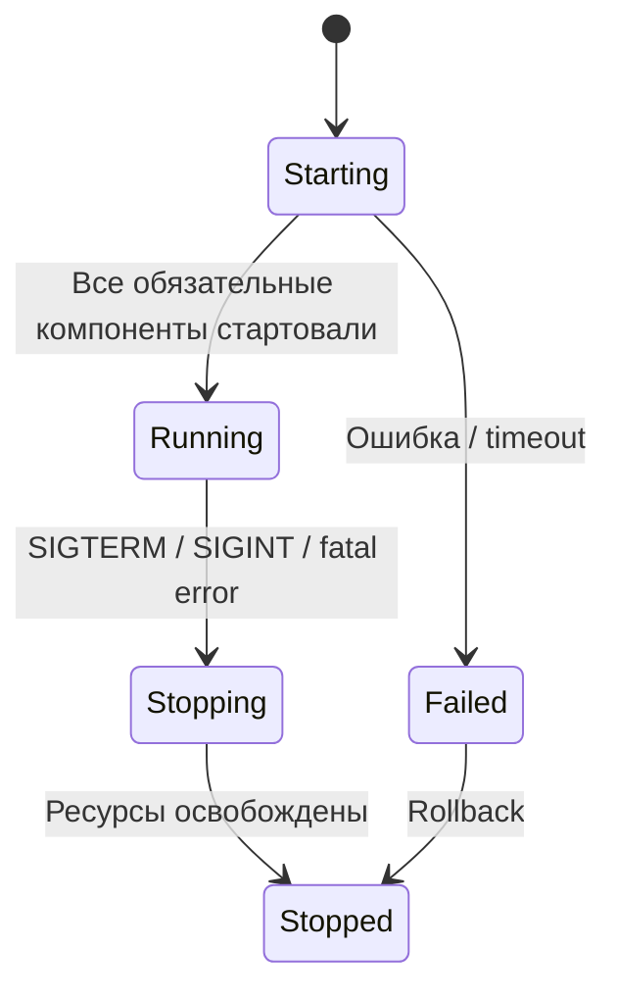

# Базовое ядро

[К оглавлению](../README.md)

Все сигнатуры в документе — проект API. Не считать их реализованными.

## 1. API и конфигурация

```go
package backendcore

func New(info app.Info, modules ...fx.Option) *fx.App
func Run(info app.Info, modules ...fx.Option)
```

`New` компонует обязательные модули, параметры Fx и модули потребителя. Ошибки создания графа доступны через `App.Err()`. `Run` делегирует Fx запуск, ожидание сигнала и остановку. Для тестов и управляемых хостов доступен `New` с явными `Start`/`Stop`. Библиотечные конструкторы не вызывают `os.Exit` и не делают `panic` при ошибках конфигурации. CLI-обёртка `Run` может завершить процесс согласно поведению Fx.

```go
type Info struct {
    Name    string
    Version string
    Commit  string
}
```

Name — обязательное непустое имя, Version по умолчанию `dev`, Commit — `unknown`. Метаданные версии задаются сервисом, например через `go build -ldflags`. Не читать имя из hostname в качестве неявной замены обязательного имени.

Предлагаемые переменные ядра:

| Переменная | Default | Ограничение |
|---|---|---|
| `SERVICE_ENVIRONMENT` | development | непустая строка |
| `LOG_LEVEL` | info | debug, info, warn, error |
| `LOG_FORMAT` | json | json, text |
| `LOG_ADD_SOURCE` | false | bool |
| `SERVICE_START_TIMEOUT` | 30s | положительная duration |
| `SERVICE_STOP_TIMEOUT` | 30s | положительная duration |

Каждый модуль владеет своим typed Config и префиксом. На первом этапе используется стандартная библиотека: env + явные настройки для тестов. Приоритет: явно переданная настройка > env > documented default. Явно заданное некорректное значение вызывает ошибку, а не молчаливую замену. Секреты без безопасного default обязательны, если функция требует их. Не логировать значения секретных переменных и DSN. Файловый config и hot reload пока вне объёма v0.1.

## 2. Lifecycle



Конструкторы проверяют настройки и создают объекты без фоновой работы, где это возможно. Fx `OnStart` открывает ресурсы, запускает workers и listeners; ошибку bind, подключения или обязательной проверки возвращает синхронно. `OnStop` отменяет рабочие контексты и освобождает ресурсы в обратном порядке. Контекст startup hook ограничен временем запуска и не используется как lifetime-контекст фоновой goroutine.

Порядок гарантируется зависимостями и явной фазой координации, а не предположением о порядке перечисления `fx.Option`. Принципы:

1. Инициализировать обязательные ресурсы и зарегистрировать обработчики до принятия трафика. Если используется ранний management listener, он возвращает readiness=false.
2. При старте обязательных ресурсов выполнить ограниченные по времени проверки. Если hook успел частично выделить ресурсы, но сам вернул ошибку, он обязан самостоятельно их очистить.
3. Переводить readiness в true только после успешного старта всех обязательных модулей. При проблемах обязательного runtime dependency readiness может стать false и восстановиться.
4. При остановке сначала сбросить readiness, прекратить приём новой работы, завершить активные HTTP/gRPC запросы и NATS consumers, затем закрыть подключения и выгрузить telemetry. Общий deadline согласуется с таймаутом оркестратора.
5. Фатальные ошибки фоновых серверов логируются и запрашивают остановку через `fx.Shutdowner`; штатное закрытие listener не считается ошибкой. Все goroutines управляемы и ограничены контекстом/таймаутом.

Явно обеспечить фазу readiness в `New` и корректный порядок graceful shutdown тестами; одной регистрации логирующего hook недостаточно. При истечении дедлайна — принудительное закрытие транспорта, отчёт об ошибке, ненулевой код завершения для фатальных ситуаций. Повторная очистка безопасна; не скрывать ошибки закрытия.

## 3. Логирование

Стандартный `log/slog` с внедрением `*slog.Logger`. JSON по умолчанию, text для локальной работы. Постоянные поля: `service`, `version`, `commit`, `environment`, опционально `instance_id`. На границе запросов — `request_id`, `trace_id`, `span_id`, при наличии контекста. Ошибки структурированы через `error`; не сериализовать целые конфиги, токены или payload без явной необходимости. Fx events направляются через `fxevent.SlogLogger`: обычные события на debug, ошибки на error. Не устанавливать глобальный slog logger из библиотечных модулей по умолчанию (важно для параллельных тестов); CLI может сделать это явно.

## 4. Health registry

Предлагаемый внутренний контракт: именованные checks `func(context.Context) error`, статус обязательности и ограничение по времени. Liveness отражает работоспособность процесса, не доступность PostgreSQL/NATS. Readiness отражает готовность принять трафик и состояние обязательных зависимостей. Проверки ограничены контекстом, не раскрывают DSN, адреса секретных систем или stack trace. При большом числе probes допускается кеш результатов на короткий TTL; проверки не создают лавину подключений.

Источники: [Fx lifecycle](https://uber-go.github.io/fx/lifecycle.html), [Fx modules](https://uber-go.github.io/fx/modules.html), [slog](https://pkg.go.dev/log/slog).
