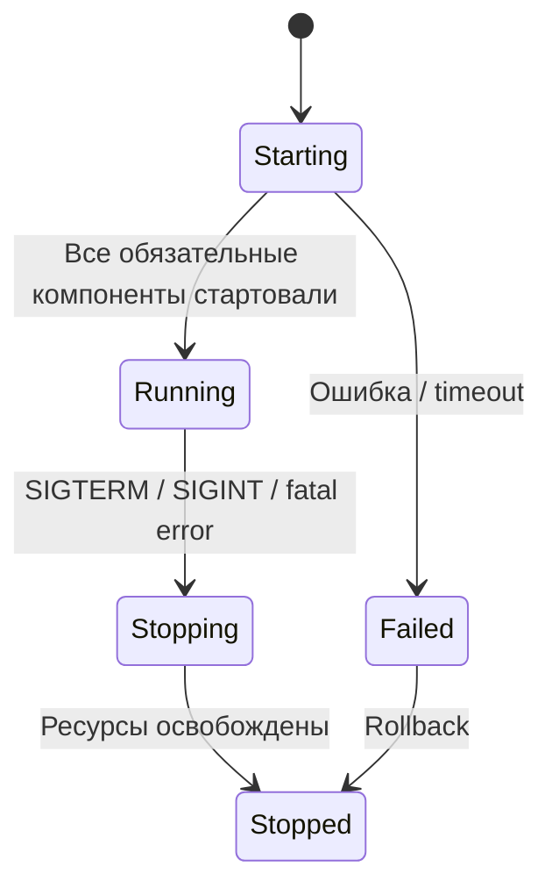

# Базовое ядро

[К описанию проекта](../README.md)

Описывает реализацию этапа 1, перенесённую из `Core` в `main`; полные проверки не подтверждены. API до первого релиза подлежит review. Полная проверка с Go 1.27 и Fx требуется в CI. Инфраструктурные модули последующих этапов здесь описаны только как требования.

## 1. API и конфигурация

```go
package backendcore

func New(info app.Info, modules ...fx.Option) *fx.App
func Run(info app.Info, modules ...fx.Option)

// Явная конфигурация, без чтения env.
func NewWithConfig(info app.Info, cfg config.Config, modules ...fx.Option) *fx.App
func NewWithOverrides(info app.Info, overrides config.Overrides, modules ...fx.Option) *fx.App
```

`New` компонует обязательные модули, параметры Fx и модули потребителя. Ошибки создания графа доступны через `App.Err()`. `Run` делегирует Fx запуск, ожидание сигнала и остановку. Для тестов и управляемых хостов доступен `New` с явными `Start`/`Stop`. Настройки таймаутов ядра необходимо разрешить **до** `fx.New`: `fx.StartTimeout`/`fx.StopTimeout` — параметры приложения, не DI-провайдеры. Ошибка загрузки/валидации превращается в `fx.Error` без открытия ресурсов. `NewWithConfig` принимает полностью разрешённую конфигурацию (не частичные zero values); `NewWithOverrides` принимает указатели на переопределяемые поля; неуказанные поля берутся из env/default. `Run` использует настроенные таймауты Fx; при прямом `Start(ctx)`/`Stop(ctx)` deadline задаёт вызывающий код. Библиотечные конструкторы не вызывают `os.Exit` и не делают `panic` при ошибках конфигурации. CLI-обёртка `Run` может завершить процесс согласно поведению Fx.

```go
type Info struct {
    Name    string
    Version string
    Commit  string
}
```

Name — обязательное непустое имя, Version по умолчанию `dev`, Commit — `unknown`. Метаданные версии задаются сервисом, например через `go build -ldflags`. Не читать имя из hostname в качестве неявной замены обязательного имени.

Переменные ядра:

| Переменная | Default | Ограничение |
|---|---|---|
| `SERVICE_ENVIRONMENT` | development | непустая строка |
| `LOG_LEVEL` | info | debug, info, warn, error |
| `LOG_FORMAT` | json | json, text |
| `LOG_ADD_SOURCE` | false | bool |
| `SERVICE_START_TIMEOUT` | 30s | положительная duration |
| `SERVICE_STOP_TIMEOUT` | 30s | положительная duration |

Каждый модуль владеет своим typed Config и префиксом. На первом этапе используется стандартная библиотека: env + явные настройки для тестов. Приоритет: явно переданная настройка > env > documented default. Явные overrides применяются типизированным способом, с различением отсутствующего значения и допустимого zero value; полностью разрешённый Config передаётся отдельно. Не использовать повторную регистрацию DI-типа для overrides. Пустое явно заданное значение не считается отсутствующим автоматически. Явно заданное некорректное значение вызывает ошибку, а не молчаливую замену. Секреты без безопасного default обязательны, если функция требует их. Не логировать значения секретных переменных и DSN. Файловый config и hot reload пока вне объёма v0.1.

## 2. Lifecycle



Конструкторы проверяют настройки и создают пассивные объекты. Открытие соединений, listeners и запуск фоновых задач до начала lifecycle запрещены для управляемых ресурсов: при ошибке сборки графа `OnStop` может не быть вызван. Для NATS/pgx и других ресурсов, появляющихся только на startup, DI предоставляет пассивный владелец ресурса с accessor к нативному типу после успешного открытия ресурса и до его закрытия (в том числе при запуске зависимых участников и drain); не внедрять ещё не созданный `*nats.Conn`/`*pgxpool.Pool` напрямую. Точные имена accessor согласуются при реализации модуля. Fx `OnStart` открывает ресурсы, запускает workers и listeners; ошибку bind, подключения или обязательной проверки возвращает синхронно. `OnStop` отменяет рабочие контексты и освобождает ресурсы в обратном порядке. Контекст startup hook ограничен временем запуска и не используется как lifetime-контекст фоновой goroutine.

### Механизм координации

Fx остаётся composition root. Для управляемых ядром ресурсов используется один внутренний координатор, регистрирующий один `fx.Hook` и получающий участников из DI value group. Это позволяет не зависеть от неопределённого порядка группы и отдельных `fx.Invoke`. Участник — небольшой набор функций открытия/активации/прекращения приёма работы/остановки (только необходимые функции), имя, зависимость от других участников. До открытия ресурсов проверить уникальность имён, отсутствующие зависимости и циклы; порядок внутри фаз детерминирован. Не создавать второй универсальный DI-контейнер. Если потребуется упрощение, альтернативный механизм допустим только при сохранении инвариантов и тестов.

| Фаза | Запуск | Остановка |
|---|---|---|
| Подготовка | Проверка конфигурации, регистрация routes/handlers, создание пассивных объектов | — |
| Ресурсы | Telemetry и необходимые DB/NATS/client resources по зависимостям | Закрытие после завершения handlers; telemetry последней |
| Транспорт | Bind и подготовка consumers/listeners; readiness=false | Снять readiness, прекратить приём новой работы |
| Работа | Активировать обработчики после подготовки обязательных ресурсов; readiness=true только после успешной активации | Завершить активную работу с дедлайном; затем закрывать зависимости |

Запуск обычных прикладных компонентов, влияющих на readiness, также должен участвовать в согласованном lifecycle (регистрация участника через предусмотренную точку расширения). Прямые произвольные `fx.Lifecycle` hooks нельзя считать охваченными гарантиями порядка ядра; нельзя использовать их для обязательных ресурсов, от которых зависит готовность, без отдельного согласования. При `New`/`Run` логировать состояние готовности координатора, а не обещать, что произвольные сторонние hooks уже закончились. Открытый API участников — `lifecycle.Participant`; координатор остаётся в `internal/coordinator`.

При частичном старте координатор сам отслеживает успешно открытые компоненты и выполняет rollback в обратном порядке; компонент, который завершился ошибкой в середине собственного Start, очищает свои частичные ресурсы. Rollback получает отдельный ограниченный контекст, а не уже отменённый startup context. Внешний Fx deadline всё равно ограничивает ожидание: предусмотреть бюджет cleanup внутри общего окна и не обещать, что Fx принудительно завершит goroutine. Ошибки cleanup объединять с исходной ошибкой; тестировать нарушение дедлайна. Panic внутри управляемого callback превращается в ошибку с именем участника и фазой, без значения panic; остальные фазы rollback/shutdown продолжаются. Ошибка Open (включая panic) не делает участника успешно открытым: его частичная очистка по-прежнему его обязанность. Это не recovery произвольной фоновой goroutine или стороннего Fx hook.

Принципы:

1. Инициализировать обязательные ресурсы и зарегистрировать обработчики до принятия трафика. Если используется ранний management listener, он возвращает readiness=false.
2. При старте обязательных ресурсов выполнить ограниченные по времени проверки. Если hook успел частично выделить ресурсы, но сам вернул ошибку, он обязан самостоятельно их очистить.
3. Переводить readiness в true только после успешного старта всех обязательных модулей. При проблемах обязательного runtime dependency readiness может стать false и восстановиться.
4. При остановке сначала сбросить readiness, прекратить приём новой работы, завершить активные RPC и management HTTP запросы и NATS consumers, затем закрыть подключения и выгрузить telemetry. Общий deadline согласуется с таймаутом оркестратора.
5. Фатальные ошибки фоновых серверов логируются и запрашивают остановку через `fx.Shutdowner`; штатное закрытие listener не считается ошибкой. Все goroutines управляемы и ограничены контекстом/таймаутом.

Явно обеспечить фазу readiness в `New` и корректный порядок graceful shutdown тестами; одной регистрации логирующего hook недостаточно. При приближении дедлайна — принудительное закрытие поддерживающего это транспорта с зарезервированным временем, отчёт об ошибке, `fx.Shutdowner.Shutdown(fx.ExitCode(1))` для фатальных runtime ошибок. Fx не может принудительно прервать произвольную goroutine или `pgxpool.Close`; для `Run` окончательный предел обеспечивается выходом процесса/оркестратором, а при прямом `Stop` ошибка возвращается владельцу. Нельзя гарантировать завершение некорректного пользовательского кода. Повторная очистка безопасна; не скрывать ошибки закрытия.

## 3. Логирование

Стандартный `log/slog` с внедрением `*slog.Logger`. JSON по умолчанию, text для локальной работы. Постоянные поля: `service`, `version`, `commit`, `environment`, опционально `instance_id`. На границе запросов — `request_id`, `trace_id`, `span_id`, при наличии контекста. Ошибки структурированы через `error`; не сериализовать целые конфиги, токены или payload без явной необходимости. Fx events направляются через `fxevent.SlogLogger`: обычные события на debug, ошибки на error. Не устанавливать глобальный slog logger из библиотечных модулей по умолчанию (важно для параллельных тестов); CLI может сделать это явно.

## 4. Health registry

Контракт: именованные checks `func(context.Context) error`, статус обязательности и ограничение по времени. Состояние процесса, обязательность проверок и результаты хранятся потокобезопасно. До старта, при остановке и после фатального сбоя readiness=false независимо от результата внешних checks. Поздний успешный check не может снова включить readiness после начала остановки. Для временной недоступности зависимости разрешено восстановление только в активной фазе. Один общий ограниченный бюджет probe, без неограниченного запуска goroutines; проверка обязана уважать context. Liveness отражает работоспособность процесса, не доступность PostgreSQL/NATS. Readiness отражает готовность принять трафик и состояние обязательных зависимостей. Проверки ограничены контекстом, не раскрывают DSN, адреса секретных систем или stack trace. `Registry.Ready(ctx)` проверяет только обязательные checks; `Registry.Probe(ctx)` возвращает имя и статус обязательных и опциональных checks. Проверки выполняются последовательно, одновременно допускается один probe; ожидание также входит в общий бюджет 2s. Panic в отдельном check трактуется как unhealthy без публикации значения panic; оставшиеся checks выполняются в рамках бюджета. Это не заменяет корректную обработку ошибок и отмены контекста в check. Кеширование не реализовано. Регистрация до startup. `Live()` возвращает true в Starting/Running/Stopping, false в Idle/Failed/Stopped.

Источники: [Fx lifecycle](https://uber-go.github.io/fx/lifecycle.html), [Fx modules](https://uber-go.github.io/fx/modules.html), [slog](https://pkg.go.dev/log/slog).

## 5. Использование и контракт участника

Минимальный сервис:

```go
import (
    backendcore "github.com/MrAmperage/ReportBoxBackendCore"
    "github.com/MrAmperage/ReportBoxBackendCore/app"
)

func main() {
    backendcore.Run(app.Info{Name: "reportbox-example"})
}
```

См. [пример](../examples/basic-service/main.go). Запуск: `go run ./examples/basic-service`. Core не открывает сетевые порты.

Управляемый компонент предоставляет `lifecycle.Participant` в Fx value group `backendcore.lifecycle`, например:

```go
fx.Provide(fx.Annotate(newParticipant,
    fx.ResultTags(`group:"backendcore.lifecycle"`)))
```

Поля: `Name`, `DependsOn`, `Open`, `Activate`, `Quiesce`, `Drain`, `Close`. Все callbacks опциональны, возвращают error, принимают context. Имена уникальны; `DependsOn` задаёт обязательные зависимости. Open выполняется для всех участников до Activate; внутри каждой фазы топологический порядок с сортировкой имён. Quiesce всех успешно активированных участников предшествует Drain всех участников, затем Close всех успешно открытых участников; порядок каждой фазы обратный. `Open` не запускает работу, `Activate` при собственной ошибке отменяет частичную активацию, `Open` при собственной ошибке очищает частично выделенные ресурсы. Успешно открытые компоненты закрываются даже если их активация не состоялась. `Close` обязан учитывать ошибки предыдущих фаз. Quiesce прекращает intake без ожидания активной работы.

При наличии startup deadline координатор резервирует 20% оставшегося времени (не более 5s и StopTimeout) для rollback. При ошибке rollback выполняется с отдельным контекстом, ограниченным StopTimeout и исходным startup deadline. На shutdown при ошибке фазы координатор продолжает cleanup; даже с отменённым контекстом callback получает возможность выполнить неблокирующее принудительное закрытие. Реализация callback должна соблюдать context; принудительное завершение произвольного Go-кода невозможно. Приложение одноразовое: после Stop/failed startup создать новый экземпляр.

`lifecycle.ReportFailure` — внедряемая функция для фатальных runtime errors: снимает readiness, логирует переданную безопасную ошибку и запрашивает остановку Fx с exit code 1. Она не заменяет обработку локальных ошибок и не должна получать секреты.

Для диагностики настройки Fx в `New` получены до построения графа. Сторонние `fx.Option` не должны переопределять таймауты, core logger или управляемый lifecycle без отдельного решения. Core не устанавливает глобальный logger. Ошибки сторонних callbacks/провайдеров могут попасть в Fx logs — адаптеры обязаны санитизировать их до возврата. Внешний API не должен выводить raw ошибки.

## 6. Проверка

Целевая версия `go 1.27.0`, Fx `v1.24.0`. Core непосредственно использует только Fx; пакет RPC добавляет ConnectRPC и Protobuf в общий Go module. Первичная таблица контрольных сумм взята из публичных файлов Fx и публичных go.sum, а не сгенерирована локальной загрузкой. Перед интеграцией выполнить `go mod tidy`, проверить diff, `go test ./...`, `go test -race ./...`, `go vet ./...`, `go build ./...`. CI содержит соответствующие проверки (кроме автоматического tidy). Локально на Go 1.23.2 проверены стандартно-библиотечные пакеты; корневой API, DI и subprocess SIGTERM требуют полной проверки на целевой версии.

`health.Registry.Running()` (добавлено при ревизии RPC) возвращает только фазу Running, не выполняет проверки зависимостей и не заменяет `Ready(ctx)`. Используется для admission RPC до старта и при остановке.

## Telemetry

`logging.New` добавляет `trace_id` и `span_id` для контекстных вызовов slog при валидном OTel SpanContext; глобальный logger/provider не меняется. См. [Telemetry](telemetry.md).
